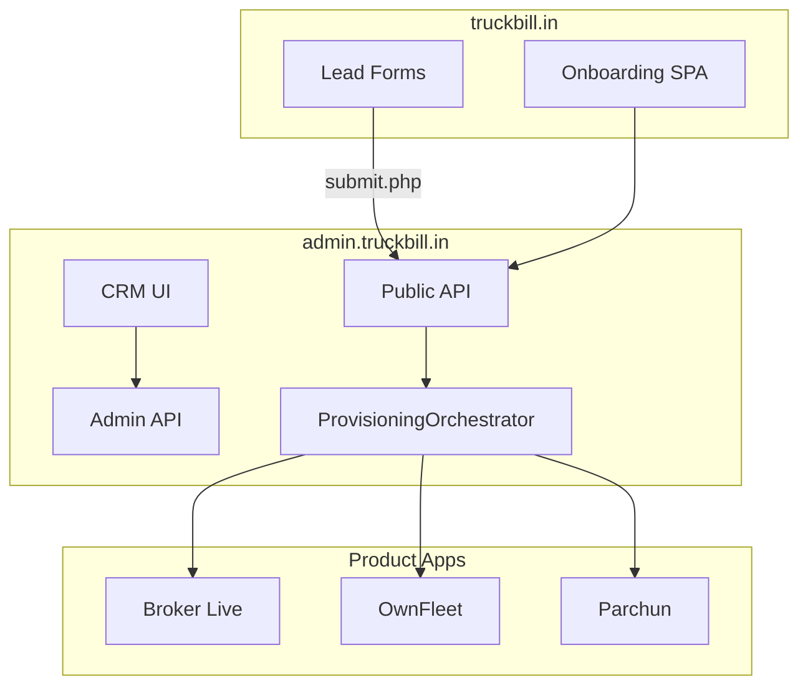

# TruckBill CRM & Onboarding Architecture

## System Overview

## Data Flow Principles

1. **Leads** enter only via website forms or manual CRM entry
2. **Onboarding UI** lives exclusively on `truckbill.in`
3. **Admin** orchestrates onboarding and provisioning — no onboarding UI
4. **Products** receive user creation only after onboarding completes
5. **Staff users** inside tenants are still managed within each product

## Key Components

| Component | Location |
|-----------|----------|
| Lead ingestion | `website/submit.php`, `website/includes/crm-client.php` |
| CRM backend | `admin/app/Http/Controllers/` |
| Onboarding engine | `admin/app/Services/Onboarding*`, `ProvisioningOrchestrator` |
| Onboarding UI | `website/onboarding/` |
| Product provisioning | `*/app/Http/Controllers/Api/OnboardingController.php` |

See also: [ER Diagram](er-diagram.md), [API Docs](api.md), [Authentication](authentication.md), [Deployment](deployment.md)
