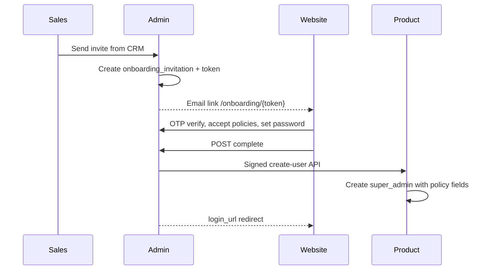

# Authentication Flows

## CRM Staff (Admin UI)

1. User visits `https://admin.truckbill.in/login`
2. Fortify session authentication (email + password)
3. Verified email required for dashboard access
4. RBAC via Spatie Permission controls lead visibility

### Roles

| Role | Permissions |
|------|-------------|
| Super Admin | Full access |
| Admin | Full CRM access |
| Sales Manager | Team leads + assign |
| Sales Executive | Assigned leads only |
| Sales Partner | Own referred leads only (create + update, no assign/invite) |
| Support | Read-only |

## Website Lead Submission

1. Visitor submits form on `truckbill.in`
2. Browser sends POST to `submit.php` with UTM metadata
3. `submit.php` forwards to Admin API with `X-Api-Key` (server-side)
4. Email notification sent as backup

## Unified Onboarding

## Security Controls

- Website API key never exposed to browser
- Onboarding tokens: SHA-256 hashed, 7-day expiry, single-use
- OTP: 6 digits, 15 min TTL, 5 attempts
- Product APIs: HMAC signing with shared secret per product
- Rate limiting on all public endpoints
