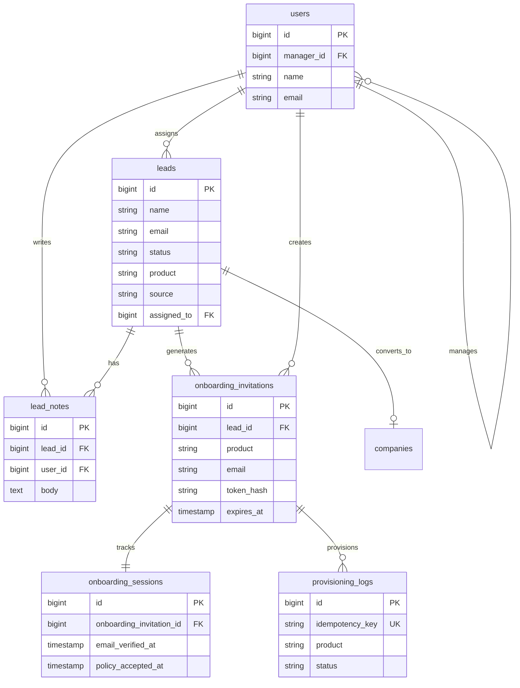

# TruckBill CRM — Entity Relationship Diagram

## Product databases (external)

Each product maintains its own `users` table with mandatory fields:

- `email_verified_at`
- `policy_accepted_at`

Provisioned via signed `POST /api/onboarding/create-user`.
