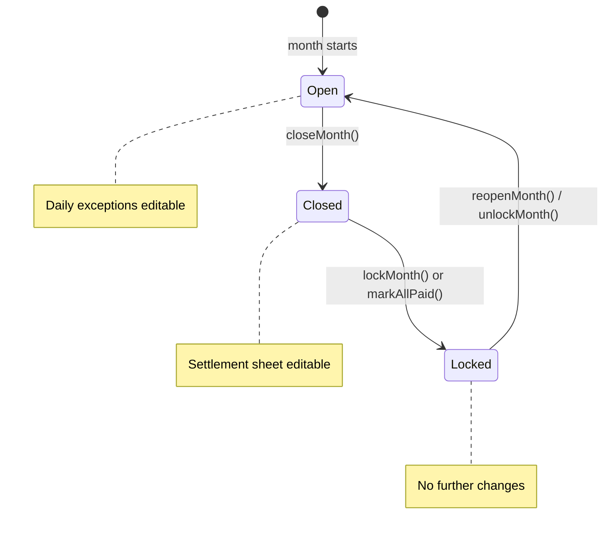
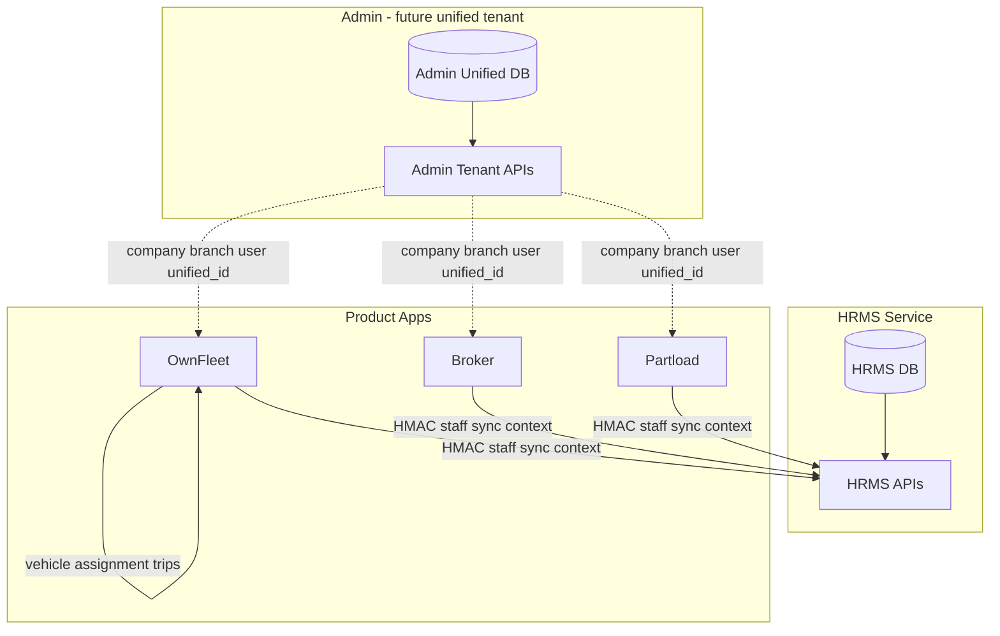
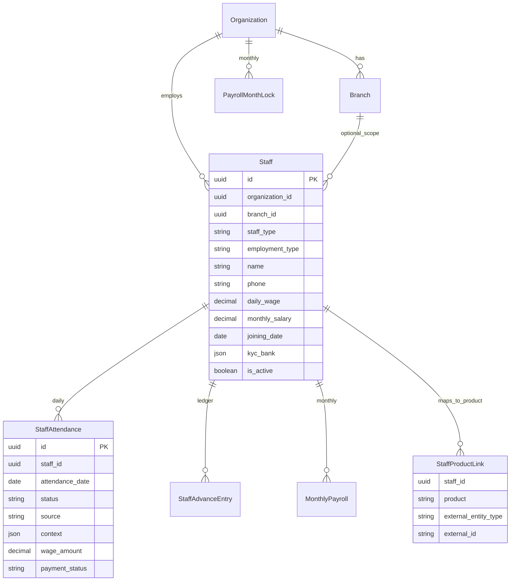
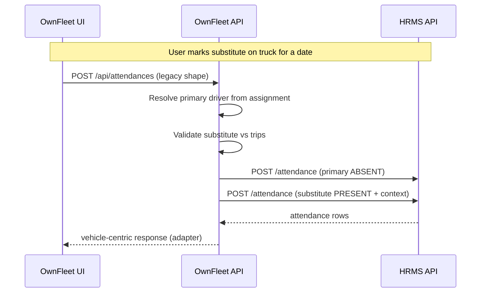

# HRMS Attendance & Payroll Plan

## Purpose

Extract attendance and basic payroll from **OwnFleet** (today tightly coupled to trucks and drivers) into a **standalone HRMS service** with APIs that all products — **OwnFleet**, **Broker**, and **Partload** — can integrate against.

The shift is conceptual and structural:

| Today | Target |
|-------|--------|
| Attendance is keyed by **vehicle + date** | Attendance is keyed by **staff + date** |
| Only **drivers** exist as workforce records | **Staff** is the universal workforce entity (drivers are one staff type) |
| Present days are **implicit** from truck assignment | Present days are recorded (or derived) **per staff member** |
| Payroll logic lives inside OwnFleet | Payroll logic lives in HRMS; products consume summaries |

Operational fleet data (vehicles, trips, driver–vehicle assignments) **stays in OwnFleet**. HRMS owns people, attendance, advances, and monthly settlement.

---

## Current State (OwnFleet Only)

Attendance and payroll exist **only in OwnFleet**. Broker and Partload have no attendance module today; tenant users are product-login staff, not tracked for daily attendance or wages.

### Data model

```mermaid
erDiagram
    Tenant ||--o{ Driver : has
    Tenant ||--o{ Vehicle : has
    Driver ||--o{ DriverAssignment : assigned
    Vehicle ||--o{ DriverAssignment : has
    Vehicle ||--o{ Attendance : "one per day"
    Driver ||--o{ Attendance : primary_or_substitute
    Driver ||--o{ MonthlyDriverWage : monthly
    Driver ||--o{ DriverAdvanceEntry : ledger
    Tenant ||--o{ AttendanceMonthLock : monthly

    Attendance {
        uuid id PK
        uuid vehicle_id UK_with_date
        uuid primary_driver_id
        uuid temporary_driver_id
        uuid wage_owner_driver_id
        date attendance_date
        string status
        decimal wage_amount
    }
```

**Unique key today:** `(tenant_id, vehicle_id, attendance_date)` — one attendance row per truck per day.

Relevant models and locations:

| Entity | Table | Notes |
|--------|-------|-------|
| Driver | `drivers` | Workforce record with `daily_wage`, KYC, bank, `joining_date` |
| Driver assignment | `driver_assignments` | Primary driver ↔ vehicle over a date range |
| Attendance | `attendances` | Exception records + wage fields; not every present day is stored |
| Monthly wage | `monthly_driver_wages` | Closed-month payroll snapshot per driver |
| Advance ledger | `driver_advance_entries` | Dr/Cr entries; recovered on monthly pay |
| Month lock | `attendance_month_locks` | `open` → `closed` → `locked` (paid); blocks edits |

### Attendance behaviour (vehicle-centric)

1. **Implicit present** — If a vehicle has an active primary driver assignment on a date and no exception row exists, the calendar treats the day as **PRESENT** for that driver. No DB row is created.
2. **Manual exceptions only** — Users cannot mark PRESENT manually. They mark:
   - `ABSENT` (optionally with substitute driver)
   - `NO_WORK_DAY` (vehicle not working; zero wage)
3. **Wage owner** — `wage_owner_driver_id` tracks who earns the day’s wage (usually the primary driver; substitute earns separately).
4. **Substitute rules** — Substitute availability is validated against other truck substitutions and open trips on the same date (`SubstituteDriverAvailability`).

### UI and APIs

- **UI:** Month grid and day view are **vehicle rows × dates** (`AttendancesIndexPage.vue`, `AttendanceMonthGrid.vue`).
- **APIs** (under `/api/attendances/*`, `/api/drivers/*`, `/api/monthly-driver-wages/*`):
  - CRUD + bulk mark attendance
  - Month overview (vehicle matrix)
  - Close / lock / reopen month
  - Monthly settlement sheet + export
  - Per-attendance and per-month wage paid markers
  - Driver advance ledger

### Payroll flow



Settlement aggregates:

- Primary driver day stats (present / absent / leave / payable days)
- Substitute earnings and substitute liability (reference amounts)
- Tenant setting `payroll_pay_days_mode` (calendar days vs fixed 26/30)
- PF, ESI, HRA, advances, diesel deduction, bonus, etc. on `monthly_driver_wages`

### Permissions (OwnFleet)

| Permission | Scope |
|------------|-------|
| `attendances.view` | View attendance |
| `attendances.manage` | Mark daily exceptions |
| `attendances.bulk_manage` | Bulk mark, month grid |
| `wages.view` | Monthly settlement read |
| `wages.manage` | Close month, mark paid, edit lines |
| `drivers.*` | Driver master |
| `driver_assignments.*` | Vehicle ↔ driver linkage |

### Gaps relative to a real HRMS

| Gap | Impact |
|-----|--------|
| Attendance tied to **truck**, not **person** | Cannot mark attendance for non-driving staff |
| **Implicit present** via assignment | Hard to audit; staff without a truck have no attendance path |
| **Driver** is the only workforce entity | Office, warehouse, loader staff unsupported |
| Payroll is **daily-wage driver** oriented | No salary structures, departments, or generic pay components |
| Logic embedded in OwnFleet | Broker / Partload cannot reuse; duplicate work if added per product |
| Vehicle settlement matrix on month lock | Fleet-specific; does not belong in a shared HRMS core |

---

## Target Architecture

A new **`hrms`** Laravel project (sibling to `admin`, `ownfleet`, `broker`, `partload`) acts as the **system of record** for workforce attendance and basic payroll.



### Principles

1. **Staff-first attendance** — Every attendance record is `(organization_id, staff_id, attendance_date)` with optional **context** metadata (e.g. vehicle, shift, site).
2. **HRMS is source of truth** for staff master (workforce), attendance, advances, and monthly payroll. Products cache what they need for UI performance.
3. **Product-specific operations stay in products** — Vehicle assignments, trips, and substitute conflict checks against trips remain in OwnFleet; HRMS receives the attendance outcome.
4. **Same auth pattern as Admin** — HMAC-signed server-to-server calls using a per-product shared secret; tenant scope via `X-Organization-Id` (or unified company UUID once Admin migration completes).
5. **Staff ≠ product user** — A staff member may or may not have a product login. Drivers often do not; office staff might map to `users` later.
6. **Phased scope** — Phase 1 covers attendance + daily/monthly wage settlement already built for drivers. Phase 2+ adds leave policies, shifts, salary structures, and statutory compliance.

### Alignment with Unified Admin Migration

The [Unified Admin Data Migration Plan](unified-admin-data-migration-plan.md) moves companies, branches, and users to Admin. HRMS should:

- Use **`organization_id`** (canonical Admin UUID) as the tenant key — not product-local `tenant_id` / `company_id`.
- Store **`hrms_entity_mappings`** per product: `staff_id` ↔ local `driver_id` (OwnFleet) or future local references.
- Accept **`branch_id`** as Admin canonical UUID; staff and attendance are branch-scoped where applicable.
- Defer HRMS cutover until Admin organization/branch IDs are stable, or implement mapping tables from day one.

---

## HRMS Domain Model (Proposed)

### Core entities



### Staff types (extensible enum)

| `staff_type` | Typical products | Notes |
|--------------|------------------|-------|
| `driver` | OwnFleet | Linked to OwnFleet `drivers` via `StaffProductLink` |
| `loader` | Partload | Warehouse / loading staff |
| `office` | All | Admin, accounts, ops |
| `sales` | Broker | Field / desk staff |
| `other` | All | Catch-all |

`employment_type`: `daily_wage` | `monthly_salary` | `contract` (phase 1: daily wage + monthly settlement mirror current driver flow).

### Attendance statuses

Keep parity with OwnFleet for migration, then extend:

| Status | Meaning |
|--------|---------|
| `PRESENT` | Worked (stored explicitly in HRMS; no more implicit-only present) |
| `ABSENT` | Did not work; may trigger deduction |
| `LEAVE` | Approved or operational leave (maps from `NO_WORK_DAY` for drivers) |
| `HALF_DAY` | Phase 2 |
| `HOLIDAY` | Phase 2 |

### Attendance `context` (JSON, optional)

Replaces vehicle columns on the attendance row. Examples:

```json
{
  "product": "ownfleet",
  "vehicle_id": "uuid",
  "vehicle_label": "MH12AB1234",
  "assignment_role": "primary",
  "substitute_for_staff_id": "uuid",
  "remarks": "Substitute for Rajesh"
}
```

For Broker office staff, `context` may be empty or `{ "site": "head_office" }`.

### Key constraint

**Unique:** `(organization_id, staff_id, attendance_date)`

Substitute work is a **second attendance row** for the substitute staff member (status `PRESENT`, context noting substitute assignment), not a column on the primary’s row.

---

## HRMS API Surface (Phase 1)

Base path: `https://hrms.truckbill.in/api/v1` (illustrative). All endpoints require HMAC auth and organization scope.

### Staff

| Method | Path | Description |
|--------|------|-------------|
| `GET` | `/staff` | List/filter by branch, type, active |
| `POST` | `/staff` | Create staff |
| `GET` | `/staff/{id}` | Detail |
| `PATCH` | `/staff/{id}` | Update |
| `DELETE` | `/staff/{id}` | Soft delete |
| `POST` | `/staff/{id}/product-links` | Link to product entity (e.g. OwnFleet driver) |
| `GET` | `/staff/by-product-link` | Resolve staff by `product` + `external_id` |

### Attendance

| Method | Path | Description |
|--------|------|-------------|
| `GET` | `/attendance` | Paginated list (filters: date range, staff, branch, status) |
| `POST` | `/attendance` | Upsert single day for one staff member |
| `POST` | `/attendance/bulk` | Bulk upsert (max 31 days) |
| `GET` | `/attendance/month-overview` | Staff × date matrix for a range |
| `DELETE` | `/attendance/{id}` | Remove explicit record (respect month lock) |

**Upsert body (example):**

```json
{
  "staff_id": "uuid",
  "attendance_date": "2026-07-05",
  "status": "PRESENT",
  "source": "ownfleet_sync",
  "context": {
    "product": "ownfleet",
    "vehicle_id": "uuid",
    "assignment_role": "primary"
  },
  "wage_amount": null
}
```

When `wage_amount` is null, HRMS computes from staff `daily_wage` and organization payroll settings (same `payroll_pay_days_mode` concept as today).

### Advances

| Method | Path | Description |
|--------|------|-------------|
| `GET` | `/staff/{id}/advances` | Ledger + balance |
| `POST` | `/staff/{id}/advances` | Dr/Cr entry |

### Monthly payroll

| Method | Path | Description |
|--------|------|-------------|
| `GET` | `/payroll/months/{yyyy-mm}` | Settlement sheet (staff lines) |
| `GET` | `/payroll/months/{yyyy-mm}/export` | Excel export |
| `POST` | `/payroll/months/{yyyy-mm}/close` | Compute snapshots |
| `POST` | `/payroll/months/{yyyy-mm}/lock` | Finalize |
| `POST` | `/payroll/months/{yyyy-mm}/reopen` | Admin rollback |
| `PATCH` | `/payroll/lines/{id}` | Edit deductions, bonus, remarks |
| `POST` | `/payroll/lines/{id}/mark-paid` | Mark staff month paid |
| `POST` | `/payroll/months/{yyyy-mm}/mark-all-paid` | Bulk pay |

### Settings

| Method | Path | Description |
|--------|------|-------------|
| `GET` | `/settings/payroll` | Pay days mode, timezone |
| `PATCH` | `/settings/payroll` | Update org payroll settings |

### Webhooks (optional Phase 1b)

HRMS pushes to products when month locked or staff updated:

- `staff.updated`
- `payroll.month.closed`
- `payroll.month.locked`

Products update local cache / disable edit UI accordingly.

---

## Product Integration Patterns

### OwnFleet (drivers + fleet context)

OwnFleet keeps:

- `vehicles`, `trips`, `driver_assignments`
- UI for fleet operators (can remain vehicle-oriented as a **view**)

OwnFleet delegates to HRMS:

- Staff master for drivers (or sync on driver create/update)
- All attendance persistence and payroll



**Nightly / on-assignment job (recommended):**

For each active primary assignment, OwnFleet calls HRMS to ensure `PRESENT` rows exist for dates in the current open month (replacing implicit present). This makes HRMS auditable without manual data entry.

**Adapter layer in OwnFleet (transition):**

- Keep existing `/api/attendances/*` routes temporarily.
- Implement `HrmsAttendanceClient` behind `AttendanceService`.
- Map vehicle-centric requests ↔ staff-centric HRMS calls.
- Deprecate direct `attendances` table writes after cutover.

### Broker & Partload (staff only)

No vehicle context. Products:

1. Create staff in HRMS when HR records are added (or shared HRMS UI later).
2. Call attendance APIs directly or via thin product wrappers.
3. Use month overview for staff × date grid (not truck grid).

Product UI permissions mirror OwnFleet: `attendances.view`, `attendances.manage`, `wages.view`, `wages.manage` — enforced in each product; HRMS validates organization scope only.

---

## Migration: Truck Attendance → Staff Attendance

### Step 1 — Staff records

For each OwnFleet `drivers` row:

1. Create HRMS `staff` with `staff_type = driver`, copy wage/KYC/joining fields.
2. Create `StaffProductLink(product=ownfleet, external_entity_type=driver, external_id=<driver.id>)`.

### Step 2 — Historical attendance rows

For each `attendances` row:

| Old field | New representation |
|-----------|-------------------|
| `primary_driver_id` + `ABSENT` / `NO_WORK_DAY` | Staff attendance for primary with same status (`NO_WORK_DAY` → `LEAVE`) |
| `temporary_driver_id` | Second staff attendance `PRESENT` for substitute with `context.substitute_for_staff_id` |
| `vehicle_id` | `context.vehicle_id` on both rows |
| `wage_amount`, payment fields | Copied to staff attendance / rolled into monthly payroll migration |

### Step 3 — Implicit present days

For each `(vehicle, date)` in closed months where assignment existed and no exception row:

- Backfill HRMS `PRESENT` for the assigned primary driver.
- Use assignment history and `AttendanceCalendarService` logic as the migration spec (script in OwnFleet one-off command).

### Step 4 — Monthly payroll

Migrate `monthly_driver_wages` → HRMS `monthly_payroll` keyed by `staff_id`.

Migrate `driver_advance_entries` → HRMS `staff_advance_entries`.

Migrate `attendance_month_locks` → HRMS `payroll_month_locks` (vehicle settlement JSON stored as OwnFleet-only extension table, not in HRMS core).

### Step 5 — Cutover

1. Dual-write period (optional): new marks go to HRMS + old table.
2. Verify settlement sheets match for 1–2 closed months.
3. Switch reads to HRMS.
4. Freeze OwnFleet `attendances`, `monthly_driver_wages`, `driver_advance_entries` tables (read-only archive).

---

## OwnFleet-Specific: What Stays vs Moves

| Concern | Location after split |
|---------|---------------------|
| Driver master (fleet) | **Split** — HRMS staff + OwnFleet link; fleet fields (license, expiry) can stay on OwnFleet driver cache |
| Vehicle ↔ driver assignment | **OwnFleet** |
| Substitute vs open trip conflict | **OwnFleet** (operational rule) |
| Attendance storage | **HRMS** |
| Month lock / settlement | **HRMS** |
| Advance ledger | **HRMS** |
| Vehicle settlement matrix on month lock | **OwnFleet** (computed from HRMS data + vehicles) |
| Attendance month grid UI | **OwnFleet** (vehicle view adapter); other products use staff grid |
| Payroll pay days setting | **HRMS** org settings |

---

## Phased Delivery

### Phase 0 — Design & project bootstrap

- [ ] Create `hrms/` Laravel app with HMAC middleware (copy pattern from Admin ↔ product APIs).
- [ ] Finalize schema and OpenAPI spec.
- [ ] Define `StaffProductLink` and mapping conventions.
- [ ] Document env vars per product: `HRMS_BASE_URL`, `HRMS_HMAC_SECRET`.

### Phase 1 — HRMS core (driver parity)

- [ ] Staff CRUD + product links.
- [ ] Attendance upsert, bulk, month overview (staff grid).
- [ ] Advances ledger.
- [ ] Monthly payroll close / lock / pay (port logic from `AttendanceService`, `MonthlySettlementService`, `AttendanceCalendarService`).
- [ ] Organization payroll settings (`payroll_pay_days_mode`).
- [ ] OwnFleet `HrmsAttendanceClient` + dual-write.
- [ ] Data migration scripts for existing tenants.
- [ ] Cutover OwnFleet attendance module to HRMS reads.

### Phase 2 — Multi-product staff

- [ ] Broker: staff attendance UI (staff × date).
- [ ] Partload: staff attendance UI.
- [ ] Shared permission names across products.
- [ ] Optional HRMS admin UI for cross-product staff directory.

### Phase 3 — HRMS depth

- [ ] Leave requests and approvals.
- [ ] Shifts and rosters.
- [ ] Monthly salary (non daily-wage) structures.
- [ ] Statutory reports (PF/ESI templates).
- [ ] Biometric / geo check-in integrations via `source` field.
- [ ] Link staff to product `users` where applicable.

---

## Risks & Decisions

| Topic | Recommendation |
|-------|----------------|
| Implicit present vs explicit rows | **Move to explicit** in HRMS; OwnFleet job backfills from assignments |
| Substitute model | **Two staff attendance rows** instead of `temporary_driver_id` column |
| Vehicle unique constraint | **Drop** at HRMS; vehicle lives in `context` only |
| Where driver license is stored | **OwnFleet** operational cache; HRMS holds generic KYC JSON |
| Admin unified IDs | **Require** `organization_id` from Admin before multi-product rollout |
| Offline / HRMS down | Products cache last-known attendance for read; queue writes (same pattern as Admin migration plan) |
| Vehicle settlement sheet | **Remain OwnFleet-only**; not blocking HRMS launch |

---

## Success Criteria

1. OwnFleet operators can mark driver attendance and run monthly settlement **without** writing to local `attendances` table.
2. Broker or Partload can onboard a daily-wage staff member and mark attendance **without** any vehicle entity.
3. Settlement totals for migrated months match pre-migration OwnFleet sheets within ₹0.01 per line.
4. Single staff member appears once in HRMS even if linked to multiple products (future).
5. All HRMS APIs are callable with HMAC auth and documented in `admin/docs/api.md` (HRMS section).

---

## References (OwnFleet implementation)

| Area | Path |
|------|------|
| Attendance model | `ownfleet/app/Attendance.php` |
| Attendance service | `ownfleet/app/Modules/DriverManagement/Services/AttendanceService.php` |
| Calendar / implicit present | `ownfleet/app/Modules/DriverManagement/Services/AttendanceCalendarService.php` |
| Monthly settlement | `ownfleet/app/Modules/DriverManagement/Services/MonthlySettlementService.php` |
| API routes | `ownfleet/routes/api-routes.php` |
| UI entry | `ownfleet/resources/js/vue-app/pages/attendance/` |
| Tests | `ownfleet/tests/Feature/Api/AttendancePhaseOneTest.php`, `AttendanceExceptionFlowTest.php` |

---

## Related Documents

- [Unified Admin Data Migration Plan](unified-admin-data-migration-plan.md) — tenant/branch/user canonical IDs
- [Architecture](architecture.md) — product ↔ Admin topology
- [Authentication](authentication.md) — HMAC signing pattern for product APIs
