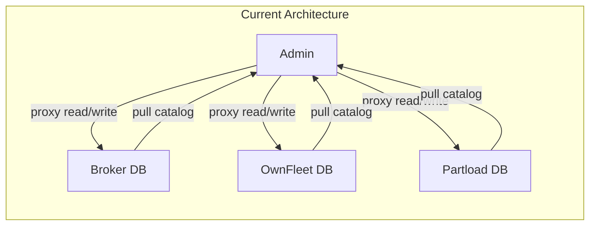
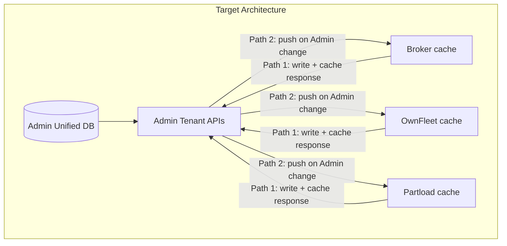
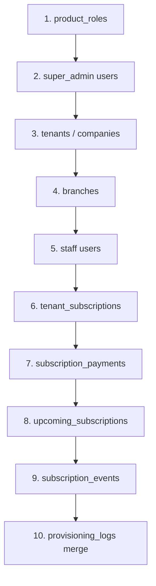
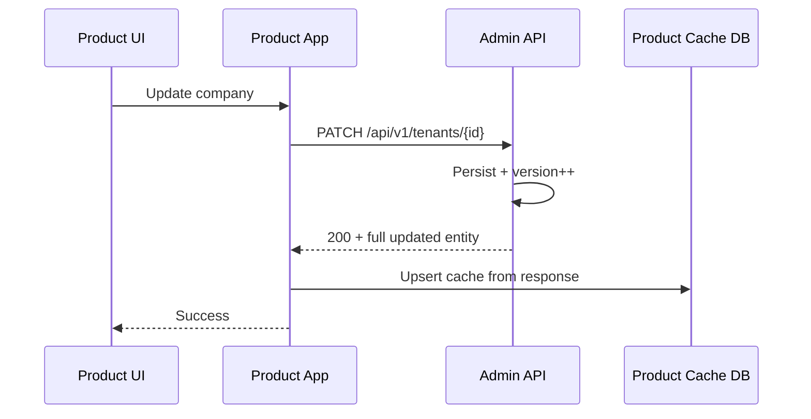
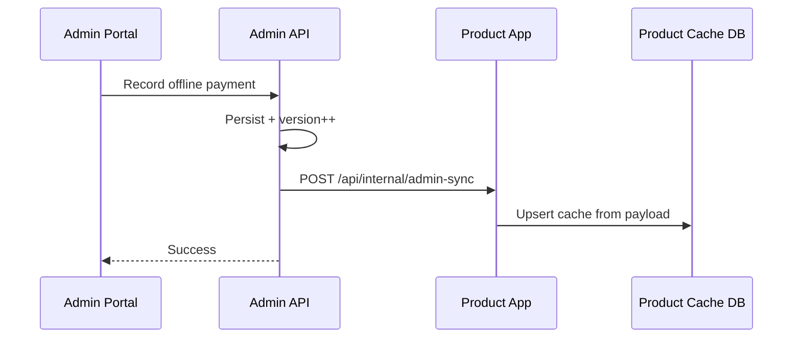

# Unified Admin Data Migration Plan

## Purpose

Migrate **common tenant data** — companies, branches, users, roles, subscriptions, and payments — from the individual product databases (`broker`, `ownfleet`, `partload`) into a **single unified store in the Admin panel**.

After migration:

1. **Admin is the source of truth** for all common tenant data.
2. **Products communicate with Admin only via HMAC-signed APIs** — no direct cross-product sharing of this data.
3. **Products maintain a persistent local cache** of Admin data for fast reads and resilience when Admin is unavailable. Cached data is **kept indefinitely** and **updated only when data changes** — via the product UI (cache from Admin API response) or the Admin portal (push to product).

Operational data (freight bookings, trips, bilties, invoices, vehicles, etc.) **stays in each product** and continues to be scoped by `company_id` / `tenant_id` / `branch_id` using the local IDs preserved during migration.

---

## Current State

Today Admin is a **control plane**, not a data store for tenants:

| Domain | Current source of truth | Integration |
|--------|------------------------|-------------|
| Leads, CRM staff, onboarding | Admin | Local DB |
| Subscription catalog, GST, promos | Admin | Product APIs pull from Admin |
| Companies / tenants | Each product | Admin **proxies** product `/api/admin/subscriptions/*` |
| Branches | Each product | No Admin involvement |
| Tenant users & product roles | Each product | Admin provisions `super_admin` via onboarding API only |
| Subscription state & payments | Each product | Admin reads/writes via product proxy API |



### Product schema differences (relevant to migration)

| Concept | Broker | OwnFleet | Partload |
|---------|--------|----------|----------|
| Company entity | `companies` (bigint PK) | `tenants` (UUID PK) | `companies` (bigint PK) |
| Branch FK | `branches.company_id` | `branches.company_id` → tenants | `branches.company_id` |
| User scope | `users.company_id`, `users.branch_id` | `users.tenant_id`, `users.branch_id` (UUID) | `users.company_id`, `users.branch_id` |
| Owner link | `companies.user_id` | `tenants.owner_user_id` | `companies.user_id` |
| Subscription table | `company_subscriptions` | `tenant_subscriptions` | `company_subscriptions` |
| Payment FK | `subscription_payments.company_id` | `subscription_payments.tenant_id` | `subscription_payments.company_id` |
| Roles | `user_roles` (name string) | `user_roles` + `permissions` pivot | Spatie `roles` / `permissions` |
| Product slug | `broker` | `ownfleet` | `parchun` |

Admin previously had a lightweight `companies` table (`lead_id`, `product`, `external_id`, `metadata`) which was **dropped** in favour of product API proxying. This migration **reintroduces** a proper unified schema, substantially expanded.

---

## Target Architecture



### Principles

1. **Admin first**: All creates/updates/deletes for common entities are persisted in Admin before the product cache is updated. Products never treat local cache as the source of truth after cutover.
2. **Persistent cache**: Products store common data in local DB tables indefinitely. There is **no TTL** on tenant entities — data stays until explicitly overwritten by an update.
3. **Two update paths** (see [Caching in Products](#caching-in-products)):
   - **Path 1** — owner acts in product UI → product calls Admin API → **cache from Admin response**
   - **Path 2** — staff acts in Admin portal → Admin pushes to product sync API → **cache from push payload**
4. **Read path**: Products always read common data from **local cache**. No routine polling or scheduled refresh.
5. **ID strategy**: Admin assigns a **canonical UUID** (`unified_id`) for every migrated entity. Products retain their **legacy local IDs** indefinitely for FK integrity with operational tables.
6. **Mapping table**: Each product stores `admin_entity_mappings` (or equivalent) linking `unified_id` ↔ local `id` per entity type.
7. **No dual-write**: After cutover, products must not write common data independently — only upsert cache rows from Admin (response or push).

---

## Scope

### In scope (migrate to Admin, sync to products)

| Entity | Notes |
|--------|-------|
| **Companies / tenants** | Name, tax IDs, address, contact, bank, logo, block status, product assignment |
| **Branches** | Name, address, contact, head office flag, product-specific branch fields stored as `metadata` JSON |
| **Tenant users** | All users with product roles (`super_admin`, `admin`, `moderator`, `accountant`, etc.) — not CRM staff |
| **Product roles & permissions** | Unified role catalog per product; permission slugs normalized |
| **Subscriptions** | Active subscription row, upcoming renewals, subscription events |
| **Subscription payments** | Full payment history including Razorpay fields and snapshots |
| **Super-admin ownership** | Company ↔ owner user relationship |
| **Referral codes** | Where tied to tenant users |
| **Onboarding provisioning logs** | Consolidated into Admin (already partially there) |

### Out of scope (remains product-local)

| Entity | Reason |
|--------|--------|
| Freight bookings, LR, invoices, vouchers | Operational domain |
| Vehicles, drivers, trips, bilties, challans | Operational domain |
| Consignees, transporters, parties, stations | Operational master data |
| Company settings / templates (broker) | Product-specific presentation; may sync as `metadata` if needed |
| CRM leads, invitations, OTP | Already in Admin |
| CRM staff users & Spatie roles | Already in Admin |
| Invoice payments (freight billing) | Operational, not SaaS |
| Geo masters (`countries`, `states`, `cities`) | Shared reference; keep replicated or reference Admin geo API in a later phase |

---

## Unified Schema (Admin)

New tables in Admin. Naming uses neutral terms (`tenant` = company/fleet account).

### Core identity

```
tenants
  id                  UUID PK
  product             enum(broker, ownfleet, parchun)
  name                string
  short_name          string nullable, unique per product
  slug                string nullable (ownfleet)
  gst_number          string nullable
  pan_number          string nullable
  gst_scheme          string nullable
  gst_type            string nullable
  gst_slab            string nullable
  address             text nullable
  contact_person      string nullable
  contact_number      string nullable
  country_id          bigint nullable
  state_id            bigint nullable
  city_id             bigint nullable
  pin_code            string nullable
  bank_name           string nullable
  account_number      string nullable
  ifsc_code           string nullable
  logo_path           string nullable
  company_type        string nullable        -- broker: Broker/Agency/Both
  timezone            string default Asia/Kolkata
  is_blocked          boolean default false
  is_active           boolean default true
  owner_user_id       UUID FK → tenant_users nullable
  lead_id             bigint FK → leads nullable
  metadata            JSON nullable            -- product-specific fields
  migrated_at         timestamp nullable
  created_at, updated_at, deleted_at

tenant_branches
  id                  UUID PK
  tenant_id           UUID FK → tenants
  name                string
  address             text nullable
  contact_number      string nullable
  is_head_office      boolean default false
  metadata            JSON nullable            -- e.g. partload GST/bank/doc prefixes
  created_at, updated_at, deleted_at

tenant_users
  id                  UUID PK
  tenant_id           UUID FK nullable          -- null for super_admin
  branch_id           UUID FK nullable
  email               string unique
  name                string
  password            string                   -- bcrypt hash, migrated as-is
  email_verified_at   timestamp nullable
  policy_accepted_at  timestamp nullable
  role_slug           string                   -- super_admin, admin, ...
  is_blocked          boolean default false
  block_reason        text nullable
  referral_code       string nullable unique
  metadata            JSON nullable
  created_at, updated_at, deleted_at
```

### Roles (unified catalog, not CRM staff roles)

```
product_roles
  id                  bigint PK
  product             enum
  slug                string                   -- super_admin, admin, ...
  name                string
  UNIQUE(product, slug)

product_permissions
  id                  bigint PK
  product             enum
  slug                string
  name                string
  group               string nullable

product_role_permissions
  role_id, permission_id
```

Partload's Spatie roles map into `product_roles` + `product_role_permissions`. Broker's simple `user_roles` and OwnFleet's permission pivot follow the same catalog.

### Subscriptions & payments

```
tenant_subscriptions
  id                  UUID PK
  tenant_id           UUID FK unique
  status              string
  starts_on, ends_on, trial_ends_on   date
  included_branches, users_per_branch, included_trucks, included_lr_credits
  addon_branches, addon_users, addon_trucks, addon_lr_credits
  lr_credits_remaining int
  last_renewed_at     timestamp nullable
  created_at, updated_at

upcoming_subscriptions
  id                  UUID PK
  tenant_id           UUID FK
  payment_id          UUID FK nullable
  status              string
  (entitlement mirror fields same as tenant_subscriptions)
  catalog_snapshot, promo_snapshot  JSON
  created_at, updated_at

subscription_payments
  id                  UUID PK
  tenant_id           UUID FK
  type, status        string
  razorpay_order_id   string unique nullable
  razorpay_payment_id, razorpay_signature  string nullable
  promo_code          string nullable
  quantities          JSON nullable
  subtotal, promo_discount, gst_amount, total_amount  decimal(12,2)
  catalog_snapshot, usage_snapshot_at_purchase, razorpay_response  JSON
  legacy_payment_ledger_id  bigint nullable
  created_at, updated_at

subscription_events
  id                  UUID PK
  tenant_id           UUID FK
  payment_id          UUID FK nullable
  actor_user_id       UUID FK nullable
  event_type          string
  metadata              JSON
  created_at
```

### Sync infrastructure (Admin)

```
entity_sync_log
  id                  bigint PK
  entity_type         string                   -- tenant, branch, user, subscription, ...
  entity_id           UUID
  product             enum
  action              enum(created, updated, deleted)
  version             bigint                   -- monotonic per entity
  payload_hash        string
  created_at
```

`entity_sync_log` supports audit, Path 2 push retries, and optional reconciliation. Products do **not** poll this log on a schedule — cache updates happen via Path 1 response or Path 2 push only.

---

## Cross-Product Field Mapping

### Company / tenant

| Unified (Admin) | Broker `companies` | OwnFleet `tenants` | Partload `companies` |
|-----------------|-------------------|--------------------|-----------------------|
| `name` | `name` | `name` | `name` |
| `short_name` | `short_name` | `short_name` | → `metadata` or generate |
| `slug` | — | `slug` | — |
| `gst_number` | `gst_number` | `gst_number` | → branch-level in partload; store in `metadata` if on company |
| `pan_number` | `pan_number` | `pan_number` | `pan_no` |
| `owner_user_id` | `user_id` | `owner_user_id` | `user_id` |
| `is_blocked` | `is_blocked` | `is_blocked` | → `metadata` |
| `company_type` | `company_type` | — | — |
| `timezone` | — | `timezone` | — |
| Bank fields | `bank`, `account_number`, `ifsc` | — | → branch in partload |

Partload moved GST/bank/doc templates to **branches** — those fields go into `tenant_branches.metadata`, not the tenant row.

### Branch

| Unified | Broker | OwnFleet | Partload |
|---------|--------|----------|----------|
| `name` | `branch_name` | `branch_name` | `name` |
| `address` | `branch_address` | `branch_address` | `address` |
| `contact_number` | `branch_contact_number` | `branch_contact_number` | `contact_number` |
| `is_head_office` | `head_office` | `head_office` | `is_head_office` |
| `metadata` | — | `trip_sequence_start` | GST, bank, doc prefixes, `bilty_print_config`, logos |

### User

| Unified | Broker | OwnFleet | Partload |
|---------|--------|----------|----------|
| `email` | `email` | `email` | `email` |
| `name` | derived from email or — | `name` | `name` |
| `tenant_id` | `company_id` | `tenant_id` | `company_id` |
| `branch_id` | `branch_id` | `branch_id` | `branch_id` |
| `role_slug` | `user_roles.name` | `user_roles.name` | Spatie role name |
| `referral_code` | `referral_code` | — | `referral_code` |

**ID type note**: Broker and Partload use bigint user IDs; OwnFleet uses UUID. Admin uses UUID everywhere; mapping tables in each product preserve legacy IDs.

### Subscription & payments

Schema is already aligned across products (June 2026 refactor). Migration is largely **1:1** with FK remapped from local company/tenant ID → Admin `tenant_id` UUID.

---

## Migration Phases

### Phase 0 — Design & scaffolding (2 weeks)

- [ ] Finalize unified schema migrations in Admin
- [ ] Add `entity_sync_log` and versioning strategy
- [ ] Define OpenAPI spec for Admin Tenant APIs (`/api/v1/tenants/*`) including **write response contract** (full entity + version)
- [ ] Define Path 2 product sync contract (`POST /api/internal/admin-sync`)
- [ ] Add `admin_entity_mappings` table to each product
- [ ] Document role/permission normalization matrix per product

**Deliverable**: Schema merged to `main`, no production data moved.

### Phase 1 — Read-only replication (3 weeks)

Goal: Admin holds a **complete copy** of product data; products remain authoritative.

- [ ] Build `MigrateProductDataCommand` in Admin — one-shot ETL per product
- [ ] Export order: roles → users (super_admin first) → tenants → branches → users (staff) → subscriptions → payments → events
- [ ] Store `product_external_mappings` in Admin: `(product, entity_type, local_id, unified_id)`
- [ ] Validate row counts, FK integrity, subscription totals, payment sums
- [ ] Admin Companies UI reads from **local Admin DB** instead of product proxy (feature flag)
- [ ] Products unchanged; continue serving traffic

**Validation gates**:
- 100% tenant/user/subscription row match per product
- Payment `SUM(total_amount)` matches within ₹0.01
- Every `super_admin` has correct `owner_user_id` linkage

### Phase 2 — Dual-write (2 weeks)

Goal: New writes go to Admin **and** products; verify sync.

- [ ] Admin becomes write entry for Admin-portal actions (Path 2): subscription overrides, offline payments, user block/unblock, company block
- [ ] `TenantWriteService` in Admin writes locally then pushes to product via sync API (Path 2 only)
- [ ] Products implement `AdminSyncController` — upsert cache from push payload (Path 2)
- [ ] Products implement `AdminApiClient` write helpers — upsert cache from API response (Path 1)
- [ ] Product subscription checkout calls Admin and caches response (temporary dual-write to local tables during transition)
- [ ] Nightly reconciliation job compares Admin ↔ product checksums

### Phase 3 — Admin authoritative / product cache (2 weeks)

Goal: Products stop writing common data locally except cache updates from Admin.

- [ ] Flip feature flag: product writes go Admin-first; **Path 1** actions cache from API response
- [ ] Product company/branch/user CRUD and subscription checkout call Admin API → **cache from response** (Path 1)
- [ ] Admin-portal changes push to product via sync API (Path 2)
- [ ] Remove product proxy routes from Admin (`ProductApiClient` subscription list/detail becomes local queries)
- [ ] Onboarding `ProvisioningOrchestrator` creates tenant + user in Admin; pushes to product (Path 2)
- [ ] Mark local common tables as **persistent cache replicas** (add `admin_sync_version` column)

### Phase 4 — Decommission product authoritative tables (1 week)

Goal: Single source of truth enforced.

- [ ] Migrate any straggler writes found by reconciliation
- [ ] Drop or archive old write triggers / model `creating` hooks on product common models
- [ ] Replace product Eloquent models for common entities with `CachedTenantRepository` reading local cache
- [ ] Remove deprecated product `/api/admin/subscriptions/*` endpoints (Admin no longer calls them)
- [ ] Update docs: `architecture.md`, `subscriptions.md`, `er-diagram.md`

### Phase 5 — Hardening (ongoing)

- [ ] Load test sync under bulk offline payment imports
- [ ] Monitor sync lag SLA (target: &lt; 5 seconds p99)
- [ ] Dead-letter queue for failed product syncs with Admin retry UI

---

## Data Migration Strategy

### ETL approach

One **idempotent** Artisan command per product:

```bash
php artisan tenants:migrate-from-product broker --dry-run
php artisan tenants:migrate-from-product ownfleet
php artisan tenants:migrate-from-product parchun
```

### Export order (respects FKs)



### ID mapping

**Admin table `product_entity_mappings`**:

| Column | Purpose |
|--------|---------|
| `product` | `broker`, `ownfleet`, `parchun` |
| `entity_type` | `tenant`, `branch`, `user`, `subscription`, `payment`, ... |
| `local_id` | Original PK in product DB (string to support UUID and bigint) |
| `unified_id` | Admin UUID |
| `migrated_at` | Timestamp |

**Each product table** gets nullable columns during transition:

```sql
ALTER TABLE companies ADD COLUMN admin_tenant_id UUID NULL;
ALTER TABLE companies ADD COLUMN admin_sync_version BIGINT DEFAULT 0;
ALTER TABLE companies ADD COLUMN admin_synced_at TIMESTAMP NULL;
```

After Phase 4, product tables may be replaced by `cached_tenants` views or slim cache tables.

### Handling duplicates & edge cases

| Scenario | Resolution |
|----------|------------|
| Same email in two products | Allowed — `tenant_users` is global unique on email; user may own tenants in multiple products |
| Same person, two products, different emails | No merge — treat as separate users unless manually linked later |
| Soft-deleted company | Migrate with `deleted_at` preserved |
| Super admin with `company_id = null` | `tenant_id = null` in Admin; session-based company selection unchanged in product |
| Partload branch-level GST | Store in `tenant_branches.metadata` |
| Ownfleet UUID vs bigint | `local_id` stored as string in mapping table |
| Legacy `payment_ledger_id` | Preserve in `subscription_payments.legacy_payment_ledger_id` |
| Password hashes | Copy bcrypt hash as-is; no re-hash |

### Reconciliation queries (examples)

```sql
-- Tenant count per product
SELECT product, COUNT(*) FROM tenants WHERE deleted_at IS NULL GROUP BY product;

-- Payment total reconciliation
SELECT product, SUM(total_amount) FROM subscription_payments sp
JOIN tenants t ON t.id = sp.tenant_id GROUP BY product;
```

Run against Admin and each product DB; totals must match pre-migration snapshots.

---

## API Design

### Admin Tenant API (new — products call Admin)

All endpoints HMAC-signed (`X-Timestamp`, `X-Signature`) using existing `ONBOARDING_SIGNING_SECRET` / product signing secret pattern.

| Method | Path | Purpose |
|--------|------|---------|
| GET | `/api/v1/tenants` | List tenants for calling product (filtered by product slug) |
| GET | `/api/v1/tenants/{id}` | Full tenant + branches + subscription summary |
| GET | `/api/v1/tenants/{id}/branches` | Branches |
| GET | `/api/v1/tenants/{id}/users` | Tenant users |
| GET | `/api/v1/tenants/{id}/subscription` | Subscription + upcoming + recent payments |
| POST | `/api/v1/tenants` | Create tenant (onboarding / in-product company create) |
| PATCH | `/api/v1/tenants/{id}` | Update tenant |
| POST | `/api/v1/tenants/{id}/branches` | Create branch |
| PATCH | `/api/v1/branches/{id}` | Update branch |
| POST | `/api/v1/tenants/{id}/users` | Create user |
| PATCH | `/api/v1/users/{id}` | Update user |
| POST | `/api/v1/tenants/{id}/subscription/checkout` | Start checkout (replaces product-local Razorpay initiate) |
| POST | `/api/v1/tenants/{id}/subscription/offline-payment` | Admin offline payment |
| PATCH | `/api/v1/tenants/{id}/subscription` | Manual override |
| GET | `/api/v1/tenants/{id}?version={n}` | On-demand fetch for cache repair (optional) |

**Write response contract (Path 1):** All `POST` / `PATCH` / `DELETE` endpoints return the **full updated entity** (or a structured payload with affected entities) plus a monotonic `version`. The calling product upserts its local cache directly from this response — no separate push back to the same product.

### Admin → Product sync (Path 2 only)

When a change originates in the **Admin portal** (not from a product API call), Admin dispatches `TenantEntityChanged` → queue job to the affected product:

```
POST {product}/api/internal/admin-sync
{
  "entity_type": "tenant",
  "action": "updated",
  "unified_id": "uuid",
  "version": 42,
  "payload": { ...full entity... }
}
```

Middleware: `VerifyAdminSyncSignature` (same HMAC scheme).

**Important:** Do not push to a product that initiated the change via Path 1 — the product already cached from the API response. Pushing to the same product for the same change risks race conditions and duplicate work.

`action` values: `created`, `updated`, `deleted` (soft deletes include `deleted_at` in payload).

### Deprecations after cutover

| Removed | Replaced by |
|---------|-------------|
| Admin `ProductApiClient` → `/api/admin/subscriptions` | Admin local DB queries |
| Product `AdminApiClient` for subscription management writes | Admin Tenant API |
| Product onboarding `create-user` only | Admin creates tenant + user, syncs to product |

Product → Admin catalog/promo APIs (`/api/v1/products/{product}/subscription-catalog`) **remain unchanged**.

---

## Caching in Products

### Model: persistent cache, update-only

Products keep common tenant data in **local database tables** permanently. Data is **not** expired or refreshed on a schedule. A cache row remains valid until an explicit update overwrites it.

This is distinct from **subscription catalog / GST settings** (pricing policy), which products may still cache in Redis with a short TTL (e.g. 24 hours) via the existing `AdminApiClient` catalog API — that is policy data, not tenant entity data.

### Cache tables

Each product maintains **read replicas** of common data. Two implementation options (pick one per product in Phase 3):

**Option A — In-place columns** (lower risk): Keep `companies`/`tenants` tables; add `admin_tenant_id`, `admin_sync_version`. Direct writes disabled; cache updated only via Path 1 response or Path 2 push.

**Option B — Dedicated cache tables** (cleaner): `cached_tenants`, `cached_branches`, `cached_users`, `cached_subscriptions`. Repositories join on `admin_*_id`. Legacy tables archived.

Recommend **Option A** for broker/partload (bigint FK stability); **Option A** for ownfleet (already UUID).

### Two update paths

#### Path 1 — Owner uses the individual product

Used when the tenant owner or staff performs an action in broker, ownfleet, or partload (edit company, add branch, subscription checkout, Razorpay webhook, etc.).



1. Product receives the user action.
2. Product calls Admin API (write).
3. Admin persists and returns the **full updated entity** with `version`.
4. Product **upserts local cache from the response**.

No push webhook back to the same product — the response is the cache update.

#### Path 2 — Staff uses the Admin portal

Used when CRM/support changes data directly in Admin (offline payment, subscription override, block company, manual user edit).



1. Admin persists the change.
2. Admin pushes to the affected product's sync API.
3. Product upserts local cache from the push payload.

### Initial population (migration only)

Before cutover, neither path applies yet. Initial cache is seeded by:

1. One-time ETL: product DB → Admin unified DB
2. Bulk sync (or per-tenant fetch) from Admin → product cache

After migration, ongoing updates use Path 1 and Path 2 only.

### Cache update rules

| Rule | Detail |
|------|--------|
| **No TTL** | Tenant profile, branches, users, subscription state — kept until overwritten |
| **Upsert, not invalidate** | Updates replace the full row; no cache-aside with lazy reload |
| **Version per entity** | Each entity carries monotonic `version`; upserts are idempotent (safe on retry) |
| **Soft deletes** | `action: deleted` or `deleted_at` in payload; cache row updated, not orphaned |
| **Admin down — reads** | Product serves from local cache |
| **Admin down — writes** | Fail or queue; do **not** write cache without Admin confirmation |
| **External webhooks** | Razorpay etc. follow Path 1: product receives webhook → forwards to Admin → caches response |

### Failure recovery (not routine refresh)

These are **optional safety nets** for missed Path 2 pushes — not scheduled cache expiry:

| Trigger | When to use |
|---------|-------------|
| Push retry + dead-letter queue | Path 2 push fails; retry with backoff |
| On-demand repair | Detect `admin_sync_version` mismatch → fetch entity once from Admin |
| Nightly reconciliation job | Compare checksums Admin ↔ product; alert on drift |
| Manual repair | `php artisan admin:sync-tenant {admin_tenant_id}` |

### What is cached locally

| Data | Lifetime | Updated via |
|------|----------|-------------|
| Tenant profile | Permanent until update | Path 1 response or Path 2 push |
| Branches | Permanent until update | Path 1 response or Path 2 push |
| Users (tenant) | Permanent until update | Path 1 response or Path 2 push |
| Subscription state | Permanent until update | Path 1 response or Path 2 push |
| Subscription payments | Permanent until update | Path 1 response or Path 2 push |
| Subscription catalog / GST settings | Short TTL (e.g. 24h) in Redis | Existing catalog API — **not** tenant entity cache |
| Product permissions catalog | Permanent until update | Path 2 push (rare changes) |

Existing `Cache::remember('subscription.settings', 24h)` in products **stays** for pricing policy only.

---

## Product Adaptation Checklist

### Broker

- [ ] Add `admin_tenant_id`, `admin_sync_version` to `companies`, `branches`, `users`, `company_subscriptions`
- [ ] `AdminSyncController` + `AdminSyncService` (Path 2 push handler)
- [ ] `AdminTenantClient` — write to Admin API and upsert local cache from response (Path 1)
- [ ] Replace `SubscriptionController` admin proxy usage — checkout calls Admin
- [ ] `Company` model: remove `creating` hook for `CompanySetting` auto-create (move to product-local concern or Admin metadata)
- [ ] `SubscriptionAccessService`: read subscription from cache, not direct DB write path
- [ ] Keep `company_settings` product-local (templates)

### OwnFleet

- [ ] Map `tenants` → Admin `tenants`; `company_id` on branches already points to tenant
- [ ] `TenantProvisioner` calls Admin create-tenant API; caches from response (Path 1)
- [ ] `SelectedCompanySession` continues using local UUID (same as `admin_tenant_id` after migration)
- [ ] Permission checks unchanged — still local `permissions` table or sync permission catalog from Admin

### Partload

- [ ] Map Spatie roles to `role_slug` on sync inbound
- [ ] Branch `metadata` for GST/bank/doc fields
- [ ] `CompanyScope` / `TenantContext` read from cache tables
- [ ] `HasRoles` trait: assign roles from synced `role_slug` column or maintain local Spatie sync

### Admin

- [ ] New models: `Tenant`, `TenantBranch`, `TenantUser`, `TenantSubscription`, etc.
- [ ] `TenantMigrationService` for ETL
- [ ] `TenantSyncDispatcher` for Path 2 push to products (Admin-portal changes only)
- [ ] Refactor `SubscriptionWebController` to query local DB
- [ ] Update `ProvisioningOrchestrator` to create full tenant in Admin
- [ ] Re-link `leads.converted_at` → `tenants.lead_id`

---

## Rollout Strategy

### Environment order

1. **Staging**: Full migration dry-run on anonymized production snapshots
2. **Production read replica**: Phase 1 — Admin populated, UI flag off
3. **Production UI read**: Admin Companies UI reads local data; compare with product proxy
4. **Dual-write**: Enable for Admin-initiated changes only
5. **Product write flip**: Per-product flag `ADMIN_TENANT_AUTHORITY=true`
6. **Cleanup**: Remove proxy code

### Per-product cutover flags

```env
# broker/.env
ADMIN_TENANT_AUTHORITY=false   # flip to true at cutover
ADMIN_API_URL=https://admin.truckbill.in
ADMIN_SYNC_WEBHOOK_SECRET=...
```

### Downtime

**Zero downtime** target. Phase 1–2 are additive. Phase 3 cutover per product can be done in a maintenance window (&lt; 30 min) if needed for write-path flip, but design aims for flag-based gradual rollout.

### Rollback

| Phase | Rollback |
|-------|----------|
| Phase 1 | Disable Admin UI flag; continue using product proxy |
| Phase 2 | Disable dual-write; products remain authoritative |
| Phase 3 | Re-enable product writes; Admin sync becomes read-only copy |
| Phase 4 | Restore from pre-migration DB snapshots (last resort) |

Keep **pre-migration DB snapshots** per product for 30 days after Phase 4.

---

## Testing & Validation

### Automated

- [ ] Pest: Admin ETL command idempotency (run twice, same counts)
- [ ] Pest: Path 1 — product write caches from Admin API response (no push to same product)
- [ ] Pest: Path 2 — HMAC sync endpoint upserts cache correctly in each product
- [ ] Pest: Subscription checkout end-to-end Admin → product cache → access tier
- [ ] Pest: Onboarding flow creates tenant in Admin and product cache
- [ ] Architecture test: no `ProductApiClient` calls to `/api/admin/subscriptions` after Phase 4

### Manual QA matrix

| Scenario | Broker | OwnFleet | Partload |
|----------|--------|----------|----------|
| Login super_admin | ✓ | ✓ | ✓ |
| Switch company (session) | ✓ | ✓ | ✓ |
| Create branch | ✓ | ✓ | ✓ |
| Create admin user | ✓ | ✓ | ✓ |
| Subscription renewal checkout | ✓ | ✓ | ✓ |
| Offline payment from Admin | ✓ | ✓ | ✓ |
| Grace period read-only | ✓ | ✓ | ✓ |
| Block company / user | ✓ | ✓ | ✓ |

### Data integrity checks (post-migration)

- Row counts per entity per product
- Sum of `subscription_payments.total_amount`
- Active subscription count
- Users with invalid `branch_id` FK
- Orphan branches (no tenant)
- `super_admin` without owned tenant

---

## Risks & Mitigations

| Risk | Impact | Mitigation |
|------|--------|------------|
| ID mismatch breaks operational FKs | High | Never change local IDs; mapping table only |
| Sync lag after Admin-portal change (Path 2) | Medium | Push retries + dead-letter queue; on-demand repair if version mismatch |
| Partload branch-level tax fields lost | Medium | `metadata` JSON on branches; explicit mapping tests |
| OwnFleet UUID/bigint interop | Medium | String `local_id` in mapping; UUID Admin IDs |
| Dual-write drift | High | Nightly reconciliation; alert on checksum mismatch |
| Admin outage blocks product writes | High | Product cache allows reads; queue writes with retry; grace period for reads |
| Password / auth disruption | High | Migrate hashes as-is; no forced reset |
| Razorpay webhook arrives at product | Low | Path 1: forward to Admin → cache from response |

---

## Timeline Estimate

| Phase | Duration | Cumulative |
|-------|----------|------------|
| Phase 0 — Design & scaffolding | 2 weeks | 2 weeks |
| Phase 1 — Read-only replication | 3 weeks | 5 weeks |
| Phase 2 — Dual-write | 2 weeks | 7 weeks |
| Phase 3 — Admin authoritative | 2 weeks | 9 weeks |
| Phase 4 — Decommission | 1 week | 10 weeks |
| Phase 5 — Hardening | 2 weeks | 12 weeks |

**Total: ~12 weeks** with one team across Admin + 3 products. Parallel work on products during Phase 0–1 can reduce calendar time.

---

## Open Decisions

| # | Question | Options | Recommendation |
|---|----------|---------|----------------|
| 1 | Geo masters in Admin? | Centralize now / later | **Later** — keep product FKs to local geo tables for Phase 1–4 |
| 2 | `company_settings` (broker templates) | Product-local / Admin metadata | **Product-local** — not common tenant identity |
| 3 | Cache update mechanism | Path 1 response only / Path 2 push only / both | **Both** — Path 1 caches from response; Path 2 pushes from Admin portal; no push back to initiating product |
| 4 | Cache table strategy | In-place vs dedicated cache tables | **In-place** for FK stability |
| 5 | Unified email across products | Global unique / per-product | **Global unique** — matches current broker/ownfleet constraints |
| 6 | CRM `companies` table revival | Extend dropped table / new `tenants` | **New `tenants` table** — dropped table was too minimal |

---

## Summary

This plan moves **all common tenant data** from `broker`, `ownfleet`, and `partload` into Admin as the **single source of truth**, while preserving **local legacy IDs** in each product for operational FK integrity. Products keep a **persistent local cache** updated only when data changes: **Path 1** (owner uses product → cache from Admin API response) and **Path 2** (staff uses Admin portal → push to product). Migration is phased: replicate first, dual-write, cutover, decommission — with zero-downtime targets and reconciliation at each gate.
